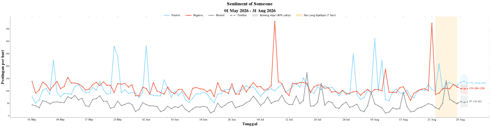

# Sentiment Volume Forecast

Forecast the daily volume of social-media posts (or unique accounts) per sentiment — positive, negative, neutral — from monitoring-tool exports, with an honest accuracy check against past data and an interactive chart.

[](https://colab.research.google.com/github/aldo02032004/sentiment-volume-forecast/blob/main/Linear_regression_forecast.ipynb)


*Example on synthetic data: solid lines = actual daily posts, dashed = forecast, shaded = 80% range, orange = days the model learned from.*

## What it does

1. **Loads** one or more exports straight from Google Drive / Google Sheets links (Excel or a zip of Excel files), retrying on dropped connections, removing duplicate posts across overlapping files and flagging days with no data at all (likely export gaps, not real zeros).
2. **Counts** posts and unique accounts per day for each sentiment.
3. **Backtests** five forecasting methods on the last 60 days, picks the most accurate one on the first 2/3 of the runs and reports scores on the last 1/3 it never saw.
4. **Draws** an interactive chart (ipywidgets): choose posts vs. accounts, how many days to forecast, how many days to learn from, and the method.

## How it works

| Method | Idea |
|---|---|
| Hari terakhir (naive) | tomorrow = today |
| Rata-rata (window mean) | tomorrow = mean of the learned days |
| Minggu lalu (seasonal naive) | tomorrow = same weekday last week |
| Regresi pintar (Ridge ARX(1)) | `log(1 + today)` from `log(1 + yesterday)` + day-of-week dummies, Ridge-regularised, forecast recursively |
| Gabungan (combination) | average of Regresi pintar and Hari terakhir |

- **Backtest (rolling origin, `sktime` `ExpandingWindowSplitter`).** For each of the last 60 days the model only sees data up to that day, forecasts the next *H* days, and is compared with what actually happened. No shuffling, no look-ahead.
- **Honest scoring.** The first 2/3 of the backtest runs choose the method and build the prediction range; the last 1/3 is used only for the scores, so the score never grades its own choice.
- **Prediction range.** Forecast + the 10th–90th percentile of the backtest errors for each step ahead, so it reflects how wrong each method really was.
- **Scores per method**, shown in a table under the chart (`e = actual − forecast`):

  | Metric | Read it as | Good when |
  |---|---|---|
  | Ketepatan | 1 − WAPE (`Σ\|e\| / Σ actual`), used to pick the method | high |
  | MASE (`sktime`) | error relative to a one-step naive forecast on the training data | < 1 |
  | MAE / RMSE (`sklearn`) | typical miss per day per sentiment; RMSE punishes spikes more | small |
  | Asli > tebakan | share of days the actual was above the forecast | ≈ 50% (median-type forecast) |
  | Coverage | share of actuals inside the 80% range, measured on unseen runs | ≈ 80% |
  | Lebar bayangan | average width of the range | narrow, as long as coverage holds |

- **Safe sliders.** Slider limits follow the data length: forecast at most ¼ of the data (max 14 days) and always keep at least 14 backtest runs.

## Results

**Honest scores** (last 1/3 of the runs) on a real 123-day monitoring dataset (not included), during a period when volume was falling:

| Setting | Regresi pintar | | Gabungan | |
|---|---|---|---|---|
| | Ketepatan | Coverage | Ketepatan | Coverage |
| Posts, 3 days ahead, learn 7 | **70.1%** | 81% | 69.8% | 79% |
| Posts, 3 days ahead, learn 28 | 69.1% | 59% | **70.3%** | **77%** |
| Posts, 7 days ahead, learn 28 | 67.2% | 58% | **68.1%** | **76%** |
| Accounts, 3 days ahead, learn 28 | 67.4% | 69% | **68.6%** | **75%** |
| Accounts, 7 days ahead, learn 28 | 67.0% | 65% | 67.0% | **78%** |

Across 16 settings, Gabungan matched or beat Regresi pintar in 15 and brought coverage from ~60% back near the 80% target. When volume shifts, a long learning window lags behind (actuals fall below the forecast and the range is too narrow); shortening it to 7–14 days or using Gabungan fixes that.

**Machine-learning comparison** on a 268-day dataset (all 60 backtest runs, learn 42 days):

| Setting | Regresi pintar | XGBoost | LightGBM |
|---|---|---|---|
| Posts, 1 day ahead | **75.4%** | 75.0% | 73.7% |
| Posts, 3 days ahead | **73.9%** | 73.5% | 72.6% |
| Posts, 7 days ahead | **72.7%** | 71.5% | 71.8% |
| Accounts, 1 day ahead | **74.1%** | 73.5% | 73.0% |
| Accounts, 3 days ahead | **72.9%** | 71.6% | 70.5% |
| Accounts, 7 days ahead | **72.1%** | 69.9% | 68.8% |

Regresi pintar also had the lowest MAE in all six settings and runs in under a second per setting (XGBoost ~7 s, LightGBM ~5 s). HistGradientBoosting, ETS, SARIMA and Theta were tried on earlier data and did not win either.

### Why not XGBoost / LightGBM?

- **Little data.** A few hundred days gives a few hundred training rows per sentiment; boosted trees need thousands to learn more than noise.
- **Trees cannot extrapolate.** They never predict outside the range seen in training, so they lag behind rising or falling volume, and the error compounds over a recursive multi-day forecast.
- **Few features.** Only past volume and the weekday are available, a pattern a small regularised linear model already captures.

Boosting becomes worth revisiting with years of data or extra daily features (news count, events, engagement).

## Quick start

[](https://colab.research.google.com/github/aldo02032004/sentiment-volume-forecast/blob/main/Linear_regression_forecast.ipynb) → `Runtime → Run all` → play with the sliders.

It runs on the bundled sample data out of the box. To use your own exports, replace the link in `SOURCES` (step 3) with Google Drive / Sheets links shared as *Anyone with the link*.

## Input format

An Excel export with one title row, then a header row containing at least:

`No, Type, Headline, Mentions, Date, Link, Media, Sentiment, Author, Followers, Retweeted, Favourited, Location`

`Date` is an ISO timestamp (`2026-05-01 13:45:00`) and `Sentiment` is `positive` / `negative` / `neutral`. The format is checked with `validate_export` from [GREAT-Tools](https://github.com/azmkto/GREAT-Tools).

## Project structure

```
├── Linear_regression_forecast.ipynb   # the whole pipeline, 7 steps
├── examples/
│   ├── make_sample_data.ipynb         # builds the synthetic export step by step (outputs included)
│   └── sample_export.xlsx             # 120 days of synthetic data
├── docs/
│   └── forecast_example.png
├── requirements.txt
└── LICENSE
```

## Limitations

- Needs at least 21 days of data (7 learned days + 14 backtest runs); with short data the honest score rests on only a handful of runs.
- Forecasts are for planning, not certainty: around 68–75% accuracy means a typical day is off by about a quarter to a third.
- Sudden spikes from new issues cannot be predicted from past volume alone.
- Daily forecasts are median-type; summing them into a weekly total tends to under-estimate.
- Code comments and the chart labels are in Indonesian.

## Built with

[GREAT-Tools](https://github.com/azmkto/GREAT-Tools) (data prep and chart style) · scikit-learn · sktime · pandas · NumPy · Matplotlib · ipywidgets

## License

MIT — see [LICENSE](LICENSE).
